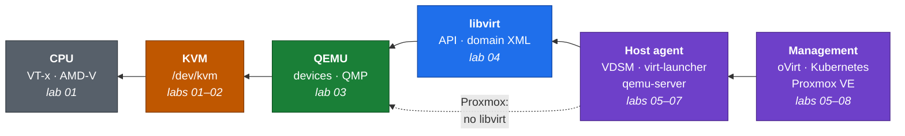

<div align="center">

# kvm-lab

**Learn the KVM virtualization stack one layer at a time**, from CPU extensions up through
QEMU, libvirt, VDSM/oVirt and KubeVirt, by building and taking apart each layer on your own
Proxmox server.

[](https://www.proxmox.com/en/proxmox-virtual-environment)
[](https://registry.terraform.io/providers/bpg/proxmox/latest)
[](https://docs.ansible.com/)
[](LICENSE)

</div>



Each lab is a short README (*why this layer exists → do it → what to notice → questions*) plus
scripts that show you the layer working. Terraform creates throwaway VMs on Proxmox, and Ansible
sets each one up for its lab. Every lab VM is itself a KVM host, running its guests with
nested virtualization.

Start with **[docs/layers.md](docs/layers.md)** for the big picture.

## The labs

| # | Lab | You'll see | Lab VM |
|---|---|---|---|
| 01 | [Hardware and KVM](labs/01-kvm/) | VT-x, the `kvm` modules, `/dev/kvm`, nested virtualization | `lab-kvm` |
| 02 | [The raw KVM API](labs/02-raw-kvm-api/) | A 150-line VMM in C that runs guest code with bare `ioctl()`s | `lab-kvm` |
| 03 | [QEMU](labs/03-qemu/) | A VM as a process: vCPU threads, guest RAM, QMP, VM exits | `lab-kvm` |
| 04 | [libvirt](labs/04-libvirt/) | Domain XML → generated QEMU command, sVirt, the libvirt API | `lab-kvm` |
| 05 | [Proxmox VE](labs/05-proxmox/) | A management stack **without** libvirt, from the outside | your PVE host |
| 06 | [VDSM](labs/06-vdsm/) | oVirt's host agent, driven directly over its JSON-RPC API | `lab-vdsm` |
| 07 | [KubeVirt](labs/07-kubevirt/) | VMs as pods: one libvirt + QEMU per `virt-launcher` | `lab-kubevirt` |
| 08 | [oVirt Engine](labs/08-ovirt-engine/) *(optional)* | Engine → VDSM → libvirt → QEMU, end to end | `lab-ovirt-engine` + `lab-vdsm` |

## What you need

- **A Proxmox VE 8.4+ or 9 host** with an Intel or AMD CPU and **nested virtualization enabled**.
  Check on the host: `cat /sys/module/kvm_intel/parameters/nested` (or `kvm_amd`) should print `Y`
  or `1`. To enable it, see the
  [Proxmox wiki](https://pve.proxmox.com/wiki/Nested_Virtualization).
- **Free resources:** 6 GB RAM for labs 01-05, 6-8 GB more for each of labs 06 and 07, and about
  14 GB for lab 08. Turn VMs on only for the lab you're doing.
- **On your computer:** [Terraform](https://developer.hashicorp.com/terraform/install) ≥ 1.6
  (or [OpenTofu](https://opentofu.org/)), [Ansible](https://docs.ansible.com/ansible/latest/installation_guide/),
  `jq`, `make`, and an SSH key.
- The lab VMs need internet access to download packages and images.

## Setup

**1. Prepare Proxmox** for Terraform. Copy [scripts/pve-setup.sh](scripts/pve-setup.sh) to the
Proxmox host and run it there as root:

```bash
bash pve-setup.sh           # or: bash pve-setup.sh <storage>   (default: local)
```

It does two things, and it's safe to re-run:

- enables the `import` content type on the image storage, so Terraform can create VM disks from
  cloud images through the API alone (no root SSH to the node)
- creates a `KvmLab` role with only the permissions Terraform needs, a `kvmlab@pve` user, and an
  API token, which it prints once. Deleting images needs one more privilege (`Datastore.Allocate`);
  it's granted on the image storage only, since at `/` it would also allow editing storage settings

**2. Configure the repo** on your computer:

```bash
cp .env.example .env                                         # paste the token line into it
cp terraform/terraform.tfvars.example terraform/terraform.tfvars
$EDITOR terraform/terraform.tfvars                           # endpoint, node, storage, bridge, SSH key
make check
```

Both files are git-ignored, so your addresses and token stay out of commits.

**3. Build the first lab VM and start:**

```bash
make lab          # terraform apply + ansible-playbook (about 10 minutes the first time)
make ssh          # you're now on lab-kvm
cd ~/labs/01-kvm && cat README.md
```

**4. Later labs:** turn their VMs on in `terraform.tfvars` (`labs = { vdsm = true }`), then run
`make lab` again and `make ssh VM=vdsm`.

## Everyday commands

| Command | Does |
|---|---|
| `make lab` | Create/update the enabled VMs and configure them |
| `make ips` | List the lab VMs and their addresses |
| `make ssh VM=kvm` | SSH in (`kvm`, `vdsm`, `kubevirt`, `ovirt_engine`) |
| `make provision` | Re-run Ansible only (e.g. after editing a lab script) |
| `make down` | Destroy all lab VMs and the cloud images Terraform downloaded |

Lab VMs are disposable: IDs 901-904 by default, tagged `kvm-lab`, not started on boot, and their
disks are excluded from backups.

## Removing everything

The lab changes your Proxmox host in exactly two places: the VMs and images Terraform creates,
and what `pve-setup.sh` adds. Undo them in that order:

```bash
make down                                   # 1. on your computer: VMs and downloaded images
```

```bash
bash pve-cleanup.sh                         # 2. on the Proxmox host: dry run, shows what it would do
bash pve-cleanup.sh --yes                   #    then remove it
```

[pve-cleanup.sh](scripts/pve-cleanup.sh) removes the token, the `kvmlab@pve` user and its
permissions, and the `KvmLab` and `KvmLabImages` roles. It removes the `import` content type only
if `pve-setup.sh` added it (setup records the storage's original settings in
`/var/lib/kvm-lab/setup.env`). It also deletes any `kvmlab-*` images `make down` missed, and it
refuses to run while VMs tagged `kvm-lab` still exist. Delete the token line from `.env` afterwards.

## Repo layout

```
docs/layers.md     the big picture: how the layers and stacks fit together
labs/NN-*/         one folder per lab: README + scripts (copied to ~/labs on each VM)
terraform/         the lab VMs on Proxmox (bpg/proxmox provider)
ansible/           one role per kind of lab host: common, kvm_host, vdsm, kubevirt, ovirt_engine
scripts/           Proxmox host setup and cleanup, SSH helper
```

## Troubleshooting

- **`/dev/kvm is missing` during Ansible:** nested virtualization is off on the Proxmox host, or
  the VM's CPU type isn't `host`. Enable nested on the host, then `make down && make lab`.
- **Terraform hangs waiting for the VM's IP (DHCP):** the guest agent hasn't reported an address.
  Check the VM's console in the Proxmox UI. On a network without DHCP, set static addresses with
  `ipv4` in `terraform.tfvars`.
- **`403 Permission check failed` from Terraform:** the token is missing a privilege. Re-run
  `pve-setup.sh` (it updates the role), or compare the role's privileges with the list in
  the script.

## License

[MIT](LICENSE)
