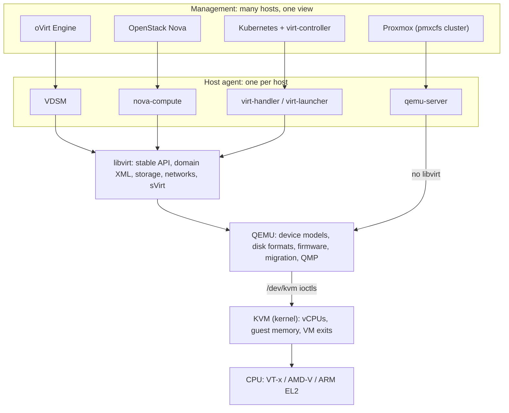

# The big picture: how the layers fit

Every KVM-based platform (Proxmox, oVirt, OpenStack, KubeVirt, and the major public clouds) is
built from the same bottom layers. They differ in what they stack on top.

## Each layer in one paragraph

**CPU extensions** add a guest mode. The CPU runs guest code natively and *exits* to the
hypervisor on sensitive operations: I/O, some privileged instructions, faults on memory it
hasn't been given. Second-level page tables (Intel EPT, AMD NPT, ARM stage-2) translate guest
memory to host memory in hardware. → [Lab 01](../labs/01-kvm/)

**KVM** is a Linux kernel module that drives those extensions. A VM is a file descriptor; a vCPU is
a file descriptor plus a thread that calls `KVM_RUN` in a loop. KVM handles hot-path exits in the
kernel and returns the rest to userspace. → [Lab 02](../labs/02-raw-kvm-api/)

**QEMU** is the userspace program that handles those exits. It emulates the rest of the computer
(chipset, firmware, disks, NICs, virtio), manages disk images, and does live migration. It's
controlled through the QMP JSON socket. → [Lab 03](../labs/03-qemu/)

**libvirt** wraps QEMU (and other hypervisors) in a stable API and declarative XML. It handles
per-host resources like storage pools, networks and security labels. Most higher layers drive it.
→ [Lab 04](../labs/04-libvirt/)

**Host agents** carry out a central controller's decisions on one host: VDSM for oVirt,
nova-compute for OpenStack, virt-handler and virt-launcher for KubeVirt. Proxmox's qemu-server
fills the same role but builds QEMU commands itself. → [Labs 05](../labs/05-proxmox/),
[06](../labs/06-vdsm/), [07](../labs/07-kubevirt/)

**Management** keeps the desired state of many hosts (which VMs exist, where they run, what storage
and networks they use) and schedules work onto host agents. → [Lab 08](../labs/08-ovirt-engine/)

## The stacks side by side

| | Desired state lives in | Host agent | Drives QEMU via | VM described as |
|---|---|---|---|---|
| Plain QEMU (lab 03) | your shell script | none | its command line + QMP | command-line flags |
| libvirt (lab 04) | `/etc/libvirt/qemu/*.xml` | libvirtd / virtqemud | QMP | domain XML |
| Proxmox VE (lab 05) | `/etc/pve` (pmxcfs, replicated by corosync) | pvedaemon + qemu-server | QMP, directly | `/etc/pve/qemu-server/<id>.conf` |
| oVirt (labs 06, 08) | Engine's PostgreSQL | VDSM (+ supervdsmd) | libvirt | engine DB → domain XML with oVirt metadata |
| OpenStack (not in this repo) | Nova's database | nova-compute | libvirt | Nova DB → domain XML |
| KubeVirt (lab 07) | Kubernetes etcd | virt-handler (per node) + virt-launcher (per VM) | libvirt, one per VM | `VirtualMachine` custom resource → domain XML |

## Things that are the same everywhere

- A running VM is **a QEMU process with one thread per vCPU**, each looping on `KVM_RUN`.
- Guest RAM is **ordinary memory in that process**, mapped into the guest by KVM.
- Control goes through **QMP**, whoever is on the other end of the socket.
- **`-cpu host`** (or a named CPU model) decides what the guest sees, and therefore whether
  live migration between different CPUs is possible.
- Nested virtualization (the lab VMs in this repo) works because the outer VM's CPU model
  exposes VT-x/AMD-V to the inner one.
